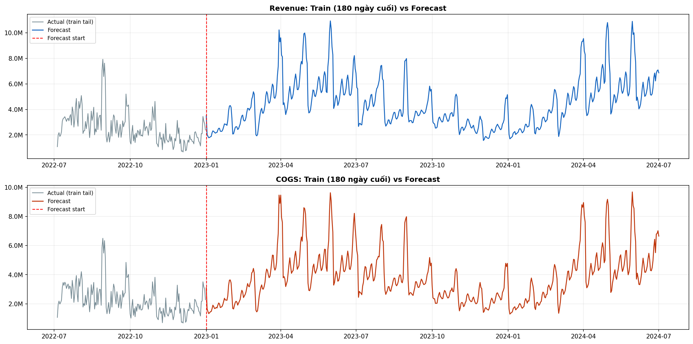
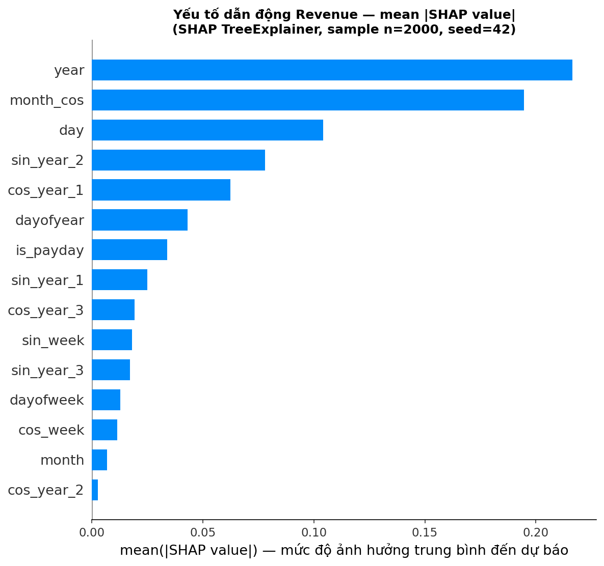
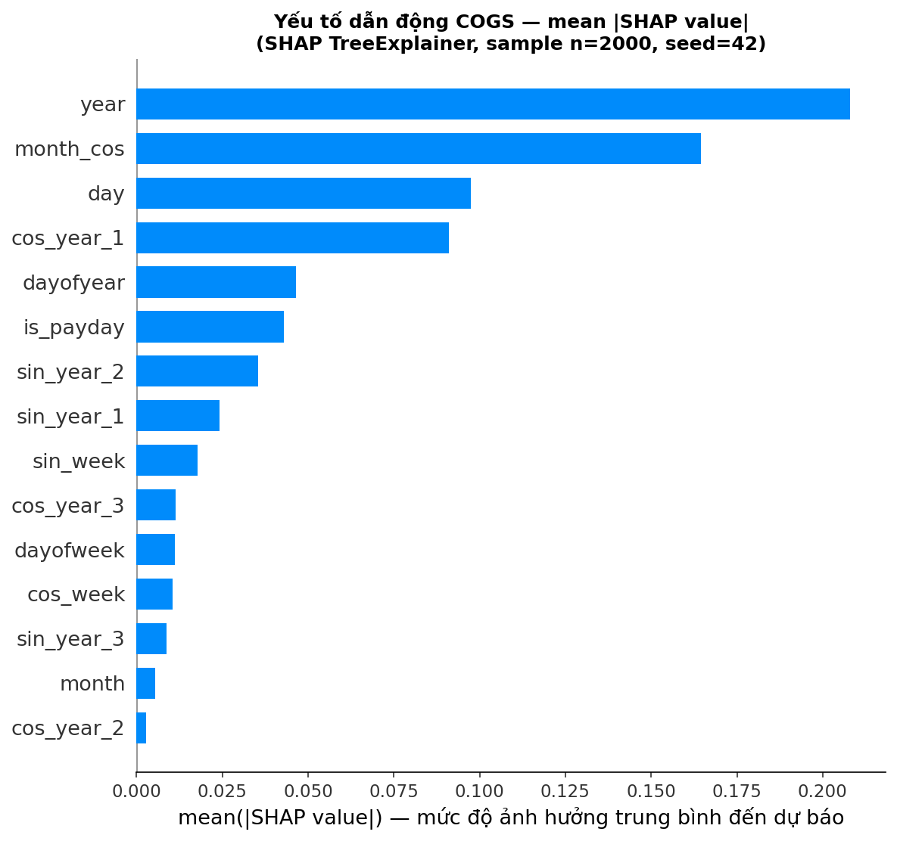

# Datathon 2026 — Phân tích dữ liệu bán lẻ thời trang

Dự án của **NEST**, thực hiện cho Datathon 2026 do VinTelligence (VinUni) tổ chức. Nhóm phân tích dữ liệu thương mại điện tử thời trang tại Việt Nam để tìm nguyên nhân làm suy giảm lợi nhuận, đánh giá hiệu quả khuyến mãi và xây dựng mô hình dự báo doanh thu.

> **Tóm tắt:** Dự án kết hợp phân tích dữ liệu giao dịch và hành vi khách hàng với dự báo chuỗi thời gian có kiểm định theo thứ tự thời gian và giải thích mô hình bằng SHAP.

## Bài toán và phạm vi

Dữ liệu lịch sử trong báo cáo trải dài từ **07/2012 đến 12/2022**, gồm giao dịch của bốn phân khúc: Streetwear, Casual, Activewear và Premium. Dự án tập trung vào hai hướng:

1. Trả lời các câu hỏi phân tích về mua hàng, sản phẩm, đổi trả, marketing, thanh toán và doanh thu theo khu vực.
2. Điều tra tác động tài chính của chương trình khuyến mãi **Urban Blowout** và dự báo doanh thu/giá vốn theo ngày cho giai đoạn **01/2023–07/2024**.

## Phương pháp và kết quả chính

### 1. Khai phá dữ liệu và phân tích kinh doanh

Notebook Phần 1 đặt ra các câu hỏi trên nhiều bảng dữ liệu bán lẻ, bao gồm:

- Khoảng cách thời gian giữa các lần mua liên tiếp.
- Tỷ suất lợi nhuận gộp theo phân khúc sản phẩm.
- Lý do trả hàng phổ biến của Streetwear.
- Tỷ lệ thoát theo nguồn truy cập và tỷ lệ đơn hàng có khuyến mãi.
- Tần suất mua theo nhóm tuổi, doanh thu theo khu vực.
- Phương thức thanh toán của đơn hàng bị hủy và tỷ lệ trả hàng theo kích cỡ.
- Giá trị thanh toán trung bình theo kế hoạch trả góp.

### 2. Đánh giá chương trình Urban Blowout

Báo cáo phân tích chiến dịch giảm giá cho Streetwear diễn ra trong tháng 8 các năm lẻ, kết hợp phân tích lợi nhuận theo thời gian, so sánh với tổng lợi nhuận tháng 8, Difference-in-Differences (DiD) và mô phỏng kịch bản điều chỉnh khuyến mãi.

- Chiến dịch có liên hệ với các đợt suy giảm lợi nhuận lặp lại; khoản lỗ từ chiến dịch chiếm **111%–119%** tổng mức lỗ tháng 8 ở các năm được phân tích.
- Phân tích DiD ước tính tổng thiệt hại ròng qua 5 chu kỳ là khoảng **340,7 triệu VNĐ**.
- Báo cáo nêu biên lợi nhuận cơ sở của Streetwear khoảng **13,2%**; mức giảm giá và ngưỡng đơn hàng thấp làm tăng rủi ro bán hàng dưới điểm hòa vốn.
- Mô hình ngoại suy tuyến tính dự báo chiến dịch có thể gây thêm khoảng **30 triệu VNĐ** lỗ gộp vào tháng 8/2023.
- Mô phỏng điều chỉnh theo độ co giãn giá (PED = 6,53) chỉ cải thiện lợi nhuận cận biên khoảng **0,4 triệu VNĐ/kỳ**. Báo cáo vì vậy đề xuất loại bỏ chiến dịch thay vì tiếp tục tinh chỉnh.

Các con số trên là kết quả được trình bày trong báo cáo dự án; xem [report.pdf](report.pdf) để biết giả định và diễn giải đầy đủ.

### 3. Dự báo doanh thu và giá vốn

Notebook Phần 3 huấn luyện mô hình riêng cho `Revenue` và `COGS` từ dữ liệu ngày trong `sales.csv` (3.833 ngày, 07/2012–12/2022). Đặc trưng được tạo từ ngày lịch, cờ cuối tuần/ngày nhận lương và mã hóa Fourier cho chu kỳ tuần, tháng, năm. Giá trị `Revenue`/`COGS` của tập dự báo không được dùng làm đặc trưng.

- **Mô hình:** LightGBM Regressor; biến đổi mục tiêu `log1p` khi huấn luyện và `expm1` khi dự báo.
- **Kiểm định:** 5-fold `TimeSeriesSplit` theo thứ tự thời gian, có early stopping; seed cố định `42`.
- **Giải thích:** SHAP `TreeExplainer`, biểu đồ mức độ quan trọng và beeswarm.
- **Đầu ra:** 548 dự báo theo ngày từ 01/01/2023 đến 01/07/2024, lưu trong `Part_3/outputs/submission.csv`.

Kết quả 5-fold cross-validation được tổng hợp trong báo cáo:

| Mục tiêu | MAE (trung bình ± độ lệch chuẩn) | RMSE (trung bình ± độ lệch chuẩn) | R² (trung bình ± độ lệch chuẩn) |
|---|---:|---:|---:|
| Revenue | 1.019.011 ± 246.339 | 1.403.847 ± 351.082 | 0,620 ± 0,125 |
| COGS | 818.682 ± 216.703 | 1.133.710 ± 312.903 | 0,666 ± 0,085 |

Theo phần diễn giải SHAP trong báo cáo, xu hướng theo năm là yếu tố quan trọng nhất với dự báo Revenue; các đặc trưng mùa vụ, ngày trong tháng và cờ ngày nhận lương cũng có ảnh hưởng đáng kể.

### Một số kết quả trực quan

**Dự báo doanh thu**



**Giải thích SHAP cho Revenue**



**Giải thích SHAP cho COGS**



## Công nghệ

- **Ngôn ngữ và xử lý dữ liệu:** Python, NumPy, pandas
- **Mô hình học máy:** LightGBM, scikit-learn
- **Giải thích mô hình:** SHAP
- **Trực quan hóa và môi trường notebook:** Matplotlib, Jupyter/IPython

## Cấu trúc repository

```text
.
├── README.md
├── requirement.txt
├── report.pdf
├── Đề thi Vòng 1.pdf
├── Part_1/
│   └── part1.ipynb
├── Part_3/
│   ├── part3.ipynb
│   ├── sales.csv
│   ├── sample_submission.csv
│   └── outputs/
│       ├── forecast_plot.png
│       ├── shap_cogs.png
│       ├── shap_revenue.png
│       └── submission.csv
└── data/
    └── sample_submission.csv
```

## Chạy notebook dự báo

Yêu cầu Python và các thư viện trong [requirement.txt](requirement.txt). Từ thư mục gốc repository:

```bash
python -m pip install -r requirement.txt
```

Mở `Part_3/part3.ipynb` bằng Jupyter, chọn thư mục làm việc là `Part_3/` rồi chạy các cell theo thứ tự. Notebook đọc `sales.csv` và `sample_submission.csv` từ thư mục hiện tại, sau đó ghi biểu đồ và tệp dự báo vào `Part_3/outputs/`.

> **Lưu ý về dữ liệu Phần 1:** `Part_1/part1.ipynb` tham chiếu nhiều bảng nguồn như `customers.csv`, `orders.csv`, `products.csv` và `web_traffic.csv` trong thư mục `data/`. Các bảng này không có trong repository hiện tại (chỉ có `data/sample_submission.csv`), nên cần bổ sung dữ liệu đầu vào được phép sử dụng và cập nhật đường dẫn trong notebook trước khi chạy. Notebook cũng import `seaborn`, thư viện hiện chưa được liệt kê trong `requirement.txt`.


> Điều chỉnh phần mô tả CV theo đúng đóng góp cá nhân và chỉ giữ các kết quả có thể giải thích, xác minh trong báo cáo.
